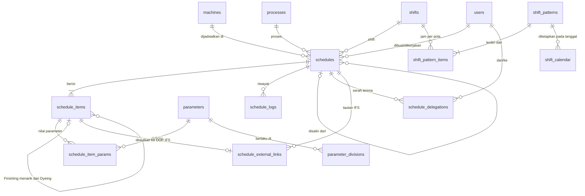

# PRD – ERP DF (ERP Dyeing Finishing)

| Item | Keterangan |
|---|---|
| Nama Produk | ERP DF |
| Versi Dokumen | 0.5 (Draft) |
| Tanggal | 23 Oktober 2026 |
| Fase Aktif | Fase 1 – Schedule Produksi |
| Status | Draft untuk review |

### Riwayat Revisi

| Versi | Perubahan |
|---|---|
| 0.1 | Draft awal: tujuan, alur approval, UI, tech stack |
| 0.2 | Keputusan edit setelah approved (diajukan ulang); Finishing menarik data Dyeing; order input manual; **delegasi tugas overshift**; **tombol link IFS per row**; **desain database header–detail–parameter terpisah**; penyesuaian dengan referensi database `erp_df.sql` |
| 0.3 | **Jam shift fleksibel** (pola shift + kalender shift per tanggal); **modal pilih data IFS** (DOP No, No SO/Order, dll) dengan **data dummy** dan arsitektur provider yang siap diganti ke integrasi nyata; `schedule_external_links` disesuaikan |
| 0.4 | Kalender shift **hanya dikelola Admin**; tautan IFS punya dua jalur: **dari form → mengisi form otomatis**, **dari schedule yang sudah ada → pencocokan data IFS vs input Scheduler**; tautan IFS kini per item; hasil pencocokan tersimpan dan terlihat oleh Kabag |
| 0.5 | Item **Finishing bisa input langsung**, Ambil dari IFS, atau Tarik dari Dyeing (semua opsional); tombol **Salin sebagai Baru**; DataTable **dikelompokkan per mesin dan collapsible**; konfirmasi satu item = satu DOP dan toleransi qty 5% |

### Keputusan yang Sudah Ditetapkan

| # | Keputusan |
|---|---|
| K1 | Schedule yang sudah *approved* lalu diedit oleh **Scheduler** harus **diajukan ulang** ke Kepala Bagian. |
| K2 | Jadwal **Finishing dapat menarik data jadwal Dyeing** yang sudah selesai diproses. |
| K3 | Data order **diinput manual** (belum terhubung modul Sales/PPIC), atau **terisi otomatis dari data IFS** lewat form (K10). |
| K4 | Proses yang belum selesai saat pergantian shift (**overshift**) dapat **didelegasikan** ke operator shift berikutnya. |
| K5 | Setiap row schedule memiliki **tombol link ke IFS** untuk mentautkan schedule dengan data di aplikasi IFS. |
| K6 | Parameter teknis kain (berat, panjang, lebar, dst.) **dipisah dari header schedule** agar header bersih dan bisa dipakai Dyeing maupun Finishing. |
| K7 | **Jam shift tidak tetap.** Pada hari tertentu jam kerja dapat lebih pendek atau jumlah shift berbeda (mis. 2 shift × 5 jam) sesuai keputusan managerial. Sistem memakai **pola shift per tanggal**. |
| K8 | Tombol IFS membuka **modal pilih data IFS** (No DOP, No SO/Order, dan data lain dari IFS). Fase ini memakai **data dummy**. |
| K9 | **Pola dan kalender shift hanya dikelola oleh Admin.** |
| K10 | Menautkan IFS **saat membuat/mengedit form** → data IFS **otomatis mengisi form**. Menautkan IFS **pada schedule yang sudah ada** → **validasi/pencocokan** data IFS dengan input Scheduler. |
| K11 | **Item Finishing tidak harus berasal dari Dyeing.** Dapat diisi langsung (input manual), lewat Ambil dari IFS, atau Tarik dari Dyeing; ketiganya opsional dan dapat dikombinasikan. |
| K12 | Scheduler dapat **Salin sebagai Baru** dari schedule yang sudah ada. |
| K13 | DataTable schedule **dikelompokkan per mesin** dan tiap grup dapat dibuka/ditutup (collapsible). |
| K14 | **Satu item schedule = satu DOP IFS**, dan toleransi selisih qty IFS vs input = **5%** (dikonfirmasi). |

---

## 1. Ringkasan

ERP DF adalah aplikasi web internal untuk mengelola operasional pabrik tekstil divisi **Dyeing** (pencelupan) dan **Finishing**. Cakupan jangka panjang meliputi modul **Manufacture** dan **Inventory**. Fase pertama berfokus pada **Sistem Schedule Produksi**: perencanaan jadwal per mesin yang disetujui Kepala Bagian, tampil di **tablet operator** dan **TV display**, serta mendukung serah terima pekerjaan antar shift dan tautan ke IFS.

### 1.1 Masalah yang Diselesaikan

- Jadwal disusun manual (Excel/kertas/WhatsApp), mudah berubah tanpa jejak.
- Operator tidak punya satu sumber informasi jadwal yang selalu update.
- Proses yang melewati pergantian shift tidak punya mekanisme serah terima yang tercatat.
- Kepala Bagian sulit memantau progres, keterlambatan, dan prioritas secara real-time.
- Data schedule terpisah dari IFS sehingga harus dicari manual.

### 1.2 Tujuan

1. Satu sumber kebenaran untuk jadwal produksi Dyeing dan Finishing.
2. Alur persetujuan yang jelas dan tercatat (Scheduler → Kepala Bagian), termasuk saat jadwal diubah setelah disetujui.
3. Jadwal yang sudah disetujui otomatis tampil di tablet operator dan TV display.
4. Serah terima proses antar shift yang tercatat dan terlihat.
5. Alur Dyeing → Finishing yang tersambung tanpa input ulang data kain.
6. Struktur data yang bersih: header generik, parameter teknis fleksibel per divisi.
7. Fondasi arsitektur modular untuk Inventory dan modul Manufacture lainnya.

### 1.3 Non-Goals (Fase 1)

- Costing, akuntansi, pembelian, penjualan.
- Integrasi mesin otomatis (IoT/PLC).
- Integrasi API dengan IFS (Fase 1 memakai data dummy di modal pilih data IFS, lihat 5.6).
- Penjadwalan otomatis berbasis AI.
- Aplikasi mobile native (cukup web responsif untuk tablet).

---

## 2. Stakeholder & Peran

Nama group mengikuti data Shield yang sudah ada pada referensi database.

| Group Shield | Peran | Tanggung Jawab di Schedule Produksi |
|---|---|---|
| `admin` | Administrator | Kelola user, role, master data, parameter, **pola & kalender shift**, konfigurasi |
| `scheduler` | Scheduler | Membuat/mengubah/menyalin jadwal, submit & ajukan ulang, mengisi item (input langsung, IFS, atau tarik Dyeing), menautkan IFS |
| `kabag` | Kepala Bagian | Approve / revisi / reject, ubah prioritas, atur ulang delegasi, pantau overshift |
| `operator` | Operator | Lihat antrean mesin di tablet, mulai/jeda/selesai, delegasi & terima serah terima |
| `viewer` | Viewer / Manajemen | Dashboard dan laporan read-only (semua user saat ini otomatis juga `viewer`) |
| `display` *(baru)* | Perangkat TV | Akun read-only untuk layar TV (token perangkat) |

Pembatasan divisi memakai permission per user (`division.dyeing`, `division.finishing`) melalui tabel `auth_permissions_users`.

---

## 3. Tech Stack & Ketentuan Teknis

| Komponen | Pilihan |
|---|---|
| Framework | CodeIgniter 4 (PHP 8.1+), **custom modular** per divisi |
| Database | MySQL/MariaDB (XAMPP), InnoDB, `utf8mb4` |
| Template UI | Falcon Admin Dashboard (Bootstrap 5) v2.8.2 |
| Tabel Data | [CodeIgniter4 DataTables (hermawan)](https://codeigniter4-datatables.hermawan.dev/) – server-side |
| Autentikasi & Hak Akses | CodeIgniter Shield (groups & permissions) |
| Realtime (TV/Tablet) | Polling AJAX (Fase 1); opsi SSE/WebSocket kemudian |

### 3.1 Struktur Folder

Namespace `App\` sudah di-autoload ke `app/`, sehingga `App\Modules\Dyeing` otomatis terbaca.

Karena **header schedule dipakai bersama**, model, service, dan migration schedule ditaruh di modul `Core`. Modul Dyeing dan Finishing berisi controller, view, dan aturan khusus divisi.

```
app/
├── Config/Routes.php                 # memuat route tiap modul
├── Modules/
│   ├── Core/                         # shared
│   │   ├── Config/Routes.php
│   │   ├── Controllers/              # master (mesin, shift, proses, parameter)
│   │   ├── Models/                   # ScheduleModel, ScheduleItemModel, ParameterModel, ...
│   │   ├── Services/
│   │   │   ├── ScheduleService.php        # CRUD + validasi bentrok
│   │   │   ├── WorkflowService.php        # state machine & approval
│   │   │   ├── DelegationService.php      # overshift & serah terima
│   │   │   ├── DyeingPullService.php      # Finishing menarik data Dyeing
│   │   │   ├── ExternalLinkService.php    # tautan IFS
│   │   │   ├── ShiftCalendarService.php   # pola shift & jam efektif per tanggal
│   │   │   ├── IfsMatchService.php        # autofill form & pencocokan data IFS vs input
│   │   │   └── Ifs/
│   │   │       ├── IfsProviderInterface.php
│   │   │       ├── DummyIfsProvider.php   # Fase 1 (data dummy)
│   │   │       └── ApiIfsProvider.php     # fase integrasi nyata
│   │   ├── Views/
│   │   └── Database/Migrations/
│   ├── Dyeing/
│   │   ├── Config/Routes.php
│   │   ├── Controllers/ScheduleController.php
│   │   └── Views/
│   ├── Finishing/                    # struktur sama dengan Dyeing
│   └── Inventory/                    # fase berikutnya
├── Views/
│   ├── Main/                         # layout Falcon (layout, navbar, sidebar)
│   │   ├── layout.php
│   │   ├── layout_display.php        # TV (tanpa sidebar)
│   │   └── layout_tablet.php         # tablet operator
│   └── Partial/                      # card insight, filter, modal, badge status
public/assets/falcon/                 # aset Falcon (dihosting lokal)
```

### 3.2 Konvensi

- Route tiap modul di `Modules/*/Config/Routes.php`, dimuat dari `app/Config/Routes.php`:

```php
foreach (glob(APPPATH . 'Modules/*/Config/Routes.php') as $routeFile) {
    require $routeFile;
}
```

- Logika bisnis ada di **Service**, bukan controller.
- Tabel mengikuti penamaan referensi database (tanpa prefix modul): `machines`, `schedules`, `schedule_items`, dst.
- Query schedule **selalu dibatasi divisi user** di Service/Model, bukan hanya di UI.
- Aset Falcon disajikan lokal agar jalan di jaringan LAN tanpa internet.
- Semua tabel DataTable memakai Hermawan DataTables (server-side).
- Zona waktu aplikasi `Asia/Jakarta`.

---

## 4. Roadmap Modul

| Fase | Modul | Isi |
|---|---|---|
| **1 (sekarang)** | Manufacture → **Schedule Produksi** | Jadwal, approval, delegasi shift, tarik Dyeing→Finishing, link IFS, tablet, TV |
| 2 | Manufacture → Work Order / Batch | Konversi schedule ke WO, hasil produksi, downtime |
| 3 | Inventory | Stok greige, dyestuff/chemical, barang jadi, mutasi, opname |
| 4 | Integrasi Manufacture ↔ Inventory | Konsumsi bahan otomatis, reservasi stok |
| 5 | Integrasi IFS lanjutan & analitik | Sinkronisasi data order dari IFS, OEE, lead time |

---

## 5. Fase 1 – Schedule Produksi

### 5.1 Alur Utama

```
[Scheduler]              [Kepala Bagian]              [Operator & TV]
 Buat jadwal (draft)
      │
      ▼
 Submit ───────────────► Review
                           │
             ┌─────────────┼────────────┐
             ▼             ▼            ▼
          Approve    Minta Revisi     Reject
             │             │
             │             ▼
             │      Scheduler perbaiki → Submit lagi
             ▼
        APPROVED ─────────────────────► Tampil di tablet & TV
             │                                │
             │                                ▼
             │                       Mulai → (Jeda) → Selesai
             │                                │
             │                    Shift berakhir & belum selesai?
             │                                ▼
             │                    OVERSHIFT → Delegasi ke shift berikutnya
             │
             └─ Scheduler edit jadwal approved ──► kembali SUBMITTED
                (diajukan ulang, hilang dari tablet/TV sampai disetujui lagi)
```

### 5.2 Status Schedule

| Status | Deskripsi | Diubah Oleh | Transisi Berikutnya |
|---|---|---|---|
| `draft` | Sedang disusun | Scheduler | `submitted`, `cancelled` |
| `submitted` | Menunggu persetujuan Kabag | Scheduler | `approved`, `revision`, `rejected` |
| `revision` | Dikembalikan Kabag dengan catatan | Kabag | `submitted` |
| `rejected` | Ditolak Kabag | Kabag | final |
| `approved` | Disetujui, **tampil di tablet & TV** | Kabag | `running`, `submitted` *(bila diedit)*, `cancelled` |
| `running` | Sedang diproses | Operator | `paused`, `done` |
| `paused` | Dijeda (kendala mesin/bahan, dll) | Operator | `running`, `cancelled` |
| `done` | Selesai | Operator | final |
| `cancelled` | Dibatalkan | Scheduler/Kabag | final |

Catatan:

- `revision` ditambahkan (tidak ada di referensi) untuk membedakan "dikembalikan untuk diperbaiki" dari "ditolak".
- Status jeda memakai nama `paused` agar sama dengan referensi database.
- **Overshift bukan status**, melainkan kondisi turunan dari `running`/`paused` (lihat 5.5).

### 5.3 Edit Schedule Setelah Disetujui (K1)

Scheduler yang mengedit schedule berstatus `approved` wajib mengajukan ulang.

| Aturan | Keterangan |
|---|---|
| Field kritis | mesin, tanggal, shift, jam mulai/selesai, urutan, prioritas, proses, item (tambah/hapus/ubah), nilai parameter rencana |
| Efek edit field kritis | Status kembali ke `submitted`, `revision_no` +1, jadwal **hilang dari tablet/TV** sampai disetujui lagi |
| Riwayat | Nilai lama–baru disimpan di `schedule_logs.changes` (JSON) |
| Field non-kritis | `notes` dan **penautan IFS tanpa menimpa nilai** dapat dilakukan **tanpa** pengajuan ulang. Bila pencocokan IFS menimpa nilai item/parameter, itu dianggap perubahan field kritis (5.6) |
| Status `running`/`paused` | **Terkunci** untuk Scheduler. Perubahan lewat tindakan operator/Kabag (jeda, batalkan, delegasi) |
| Peringatan UI | Sebelum menyimpan, tampilkan konfirmasi: "Jadwal akan diajukan ulang dan sementara tidak tampil di tablet/TV" |

### 5.4 Sumber Item Finishing: Input Langsung atau Tarik dari Dyeing (K2, K11)

Tidak semua pekerjaan Finishing berasal dari Dyeing internal (mis. kain dari pihak luar atau stok kain yang sudah dicelup). Karena itu item Finishing dapat diisi dengan **tiga cara**, semuanya opsional dan dapat **dikombinasikan dalam satu schedule**:

| Cara | Tombol di form | Hasil |
|---|---|---|
| **Input langsung** | Tambah Baris | Scheduler mengisi order, customer, kain, warna, lot, dan parameter Finishing secara manual. Parameter wajib mengikuti `parameter_divisions.is_required` divisi Finishing |
| **Ambil dari IFS** | Ambil dari IFS | Item terisi otomatis dari data IFS (5.6 jalur A) |
| **Tarik dari Dyeing** | Tarik dari Dyeing | Item terisi dari hasil Dyeing yang sudah selesai (bagian ini) |

Sistem **tidak mewajibkan** schedule Finishing memiliki referensi Dyeing. Asal item dicatat di `schedule_items.source_type` (`manual`, `ifs`, `dyeing`) untuk keperluan filter dan laporan.

#### Tarik dari Dyeing

Jadwal Finishing dapat memakai hasil Dyeing yang sudah selesai tanpa input ulang data kain.

**Alur penarikan:**

1. Scheduler Finishing membuka form schedule → tombol **"Tarik dari Dyeing"**.
2. Muncul modal berisi DataTable item Dyeing dengan syarat:
   - header Dyeing berstatus `done`,
   - belum ditarik ke Finishing (atau masih ada sisa).
3. Scheduler mencentang satu/lebih item lalu klik **Tarik**.
4. Sistem membuat baris `schedule_items` Finishing dengan:
   - `order_no`, `customer_name`, `article`, `color_*`, `lot_no` disalin dari item Dyeing,
   - `source_type = dyeing` dan `source_item_id` menunjuk ke item Dyeing (jejak asal),
   - parameter yang **dipakai kedua divisi** (mis. berat, panjang, lebar) disalin dari nilai **aktual** Dyeing menjadi nilai **rencana** Finishing; bila aktual kosong, memakai nilai rencana,
   - parameter khusus Dyeing tidak disalin.
5. Scheduler dapat mengedit hasil tarikan sebelum submit.

**Aturan:**

- Item Dyeing yang sudah ditarik ke Finishing aktif ditandai "Sudah ditarik" dan tidak muncul lagi di modal. Bila jadwal Finishing-nya `cancelled`/`rejected`, item kembali tersedia.
- Penarikan sebagian (qty lebih kecil dari hasil Dyeing) diperbolehkan. Sisa tetap tersedia selama masih ada.
- Halaman detail Finishing menampilkan tautan balik ke schedule Dyeing asal.
- Data hasil tarikan adalah **salinan**; perubahan di Finishing tidak mengubah data Dyeing.
- Bila item Dyeing memiliki tautan IFS, tautan (beserta snapshot) ikut disalin ke item Finishing, lalu status kecocokannya dihitung ulang.

### 5.5 Delegasi Tugas saat Overshift (K4)

**Definisi overshift:** schedule berstatus `running` atau `paused` saat waktu sudah melewati akhir shift yang sedang memegang pekerjaan tersebut, **menurut jam efektif shift pada tanggal itu** (lihat 5.9), ditambah toleransi `schedule.overshift_grace_minutes` (default 15 menit).

Shift yang sedang memegang pekerjaan dicatat di `schedules.current_shift_id` + `current_shift_date`, diisi saat operator menekan **Mulai** (berdasarkan waktu aktual) dan diperbarui saat serah terima diterima. Cara ini juga mendukung proses panjang yang melewati lebih dari dua shift.

Deteksi dilakukan **on-the-fly** saat polling (tanpa cron), sehingga cocok untuk XAMPP.

**Alur serah terima:**

```
Shift berakhir, proses belum selesai
        │
        ▼
 Tablet operator lama: banner merah "Overshift – Serahkan"
 TV: badge OVERSHIFT     Kabag: card "Overshift" bertambah
        │
        ▼
 Operator lama (atau Kabag) buat DELEGASI:
   - target: operator tertentu ATAU "shift berikutnya (siapa saja)"
   - catatan serah terima (tahap proses, kondisi, kendala)
   - estimasi sisa waktu (menit)
        │
        ▼  status delegasi: pending
 Tablet operator shift berikut: kartu "Serah Terima Masuk"
        │
   ┌────┴──────────┐
   ▼               ▼
 TERIMA          TOLAK (alasan wajib)
   │               │
   ▼               ▼
 current_operator  Kabag diberi tahu,
 & current_shift   Kabag menunjuk operator
 diperbarui        (assign paksa)
```

**Aturan:**

| # | Aturan |
|---|---|
| D1 | Proses di mesin **tidak berhenti** saat delegasi; waktu aktual tetap berjalan sejak `actual_start`. |
| D2 | Selama delegasi `pending`, tanggung jawab tetap pada operator lama. |
| D3 | Saat diterima, `current_operator_id`, `current_shift_id`, `current_shift_date` berpindah ke penerima. |
| D4 | Delegasi yang tidak direspons lebih dari `schedule.handover_escalation_minutes` (default 15 menit) ditandai **eskalasi** dan muncul di Kabag. |
| D5 | Kabag dapat **assign paksa** (langsung berstatus `accepted`, tercatat `type = kabag`). |
| D6 | Satu schedule hanya boleh punya satu delegasi `pending` pada satu waktu. |
| D7 | Yang menekan **Selesai** dicatat di `finished_by`. Seluruh rantai pemegang tercatat di tabel delegasi. |
| D8 | Target delegasi dipilih dari user `operator` yang punya permission divisi yang sama. (Jadwal roster operator per shift ada di backlog.) |
| D9 | Jadwal `approved` yang **belum dimulai** sampai shift berakhir bukan overshift. Itu dihitung "Terlambat" dan ditangani Scheduler/Kabag (atur ulang jadwal). |
| D10 | "Shift berikutnya" adalah **shift aktif berikutnya menurut kalender shift**, bisa pada tanggal berikutnya bila shift hari itu sudah habis atau hari berikutnya libur. |
| D11 | Bila pola shift hari berjalan diubah manajemen, deteksi overshift langsung memakai jam yang baru. |

### 5.6 Tautan IFS (K5, K8, K10)

Data IFS (No DOP, No SO/Order, dan data lain) dapat ditautkan lewat **dua jalur** dengan perilaku berbeda:

| Jalur | Dibuka dari | Perilaku |
|---|---|---|
| **A. Dari form** | Tombol **Ambil dari IFS** di bagian Item pada form buat/edit schedule | Data IFS yang dipilih **otomatis mengisi** form |
| **B. Pada schedule yang sudah ada** | Tombol **IFS** di setiap row DataTable | Data IFS **dicocokkan** dengan input Scheduler, lalu ditautkan |

Kedua jalur memakai modal pemilihan data IFS yang sama. Pada Fase 1 data IFS berasal dari **data dummy**; hanya *provider* data yang diganti saat integrasi nyata tersedia (lihat "Arsitektur Provider").

#### Modal Pemilihan Data IFS (dipakai jalur A dan B)

```
┌─ Pilih Data IFS ───────────────────────────────────────────────┐
│  Cari: [DOP / No SO / customer / part ...]   Status IFS: [▼]   │
│ ┌──┬────────────┬─────────────┬──────────┬─────────┬─────┬────┐│
│ │☐ │ DOP No     │ No SO/Order │ Customer │ Part    │Warna│ ...││
│ │☑ │ DOP-…0001  │ SO-26-10001 │ Cust. A  │ CVC 30s │Navy │ ⭐ ││
│ │☐ │ DOP-…0002  │ SO-26-10001 │ Cust. A  │ CVC 30s │Blck │ ⭐ ││
│ │☐ │ DOP-…0003  │ SO-26-10002 │ Cust. B  │ TC 24s  │Whte │    ││
│ └──┴────────────┴─────────────┴──────────┴─────────┴─────┴────┘│
│  ⭐ Disarankan = No SO/Order sama dengan order di schedule/form │
│  ⓘ "Sudah ditautkan ke SCH-…" tampil bila DOP dipakai schedule  │
│     lain (informasi, bukan larangan)                           │
│                                     [Batal]  [Lanjut (1)]      │
└────────────────────────────────────────────────────────────────┘
```

**Kolom data IFS** *(kolom di luar DOP No dan No SO/Order adalah asumsi dan akan disesuaikan dengan field IFS yang sebenarnya)*:

| Kolom | Keterangan |
|---|---|
| DOP No | Nomor DOP dari IFS |
| No SO / Order | Nomor Sales Order / order dari IFS |
| Customer | Nama customer |
| Part / Artikel | Kode atau nama kain |
| Warna | Warna pesanan |
| Qty + Satuan | Kuantitas pesanan |
| Due Date | Tanggal jatuh tempo |
| Status IFS | Planned, Released, In Process, dst. |

**Contoh data dummy** (tabel `ifs_dummy_orders`, diisi seeder):

| DOP No | No SO/Order | Customer | Part / Artikel | Warna | Qty | Due Date | Status IFS |
|---|---|---|---|---|---|---|---|
| DOP-2610-0001 | SO-26-10001 | Customer A | CVC 30s Single Jersey | Navy | 1.200 kg | 2026-10-30 | Released |
| DOP-2610-0002 | SO-26-10001 | Customer A | CVC 30s Single Jersey | Black | 850 kg | 2026-10-30 | Released |
| DOP-2610-0003 | SO-26-10002 | Customer B | TC 24s Pique | White | 2.000 kg | 2026-11-02 | Released |
| DOP-2610-0004 | SO-26-10003 | Customer C | CD 30s Rib | Maroon | 640 kg | 2026-11-03 | Planned |
| DOP-2610-0005 | SO-26-10004 | Customer D | Polyester Micro Fleece | Grey | 1.500 kg | 2026-11-05 | Released |
| DOP-2610-0006 | SO-26-10005 | Customer E | Cotton 40s Single Jersey | Royal Blue | 980 kg | 2026-11-06 | In Process |
| DOP-2610-0007 | SO-26-10006 | Customer B | TC 20s Fleece | Beige | 1.750 kg | 2026-11-09 | Released |
| DOP-2610-0008 | SO-26-10007 | Customer A | Lycra Spandex Jersey | Red | 430 kg | 2026-11-10 | Planned |

---

#### Jalur A – Dari Form: Mengisi Form Otomatis

Tombol **Ambil dari IFS** tersedia di bagian Item pada form **buat** maupun **edit** schedule (`draft`/`revision`, atau `approved` yang sedang diedit).

**Alur:** klik tombol → pilih satu atau lebih data IFS → **Lanjut** → form terisi.

**Pemetaan data IFS → item schedule:**

| Data IFS | Terisi ke | Catatan |
|---|---|---|
| No SO / Order | `schedule_items.order_no` | |
| Customer | `schedule_items.customer_name` | |
| Part / Artikel | `schedule_items.article` | |
| Warna | `schedule_items.color_name` | |
| Qty + Satuan | Nilai **rencana** parameter utama divisi | Terisi hanya bila satuan IFS sama dengan satuan parameter utama (mis. kg → `BERAT` pada Dyeing). Bila beda, tidak diisi dan muncul petunjuk |
| DOP No | Tautan IFS item (`schedule_external_links`) | Tampil sebagai badge DOP di baris item |
| Due Date | Info di baris item (tidak disimpan di item) | Dipakai untuk peringatan jadwal melewati due date |

**Aturan jalur A:**

| # | Aturan |
|---|---|
| A1 | **Satu data IFS (DOP) menjadi satu baris item.** Memilih 3 DOP menambah 3 baris item. |
| A2 | Baris item kosong yang sudah ada dipakai lebih dulu; selebihnya menambah baris baru. **Isian yang sudah diketik Scheduler tidak pernah ditimpa.** |
| A3 | DOP yang sudah ada di form ini dilewati. |
| A4 | Hasil isian tetap **dapat diedit**. Field yang berasal dari IFS diberi penanda "IFS"; bila diubah hingga berbeda dari IFS, muncul penanda kuning "berbeda dari IFS" (peringatan, tidak memblokir). |
| A5 | Tautan baru **disimpan bersama schedule** saat tombol Simpan ditekan. Saat simpan, status kecocokan dihitung ulang dan disimpan (`matched` atau `mismatch_kept`). Pada jalur ini tidak perlu alasan. |
| A6 | Melepas DOP dari baris item hanya menghapus tautan dan penanda IFS; isian item tetap. |

---

#### Jalur B – Pada Schedule yang Sudah Ada: Pencocokan Data

Klik tombol **IFS** pada row → modal 3 langkah: **1 Pilih Data IFS → 2 Cocokkan Data → 3 Konfirmasi**. Modal juga memiliki tab **Tertaut (n)** untuk melihat, membuka, dan melepas tautan yang sudah ada.

**Langkah 2 – Cocokkan Data** (satu blok per DOP terpilih):

```
┌─ DOP-2610-0001 ⇄ Item #1  [SO-26-10001 ▼]  ⭐ otomatis dari No SO ─┐
│ ┌──────────┬─────────────┬───────────────┬──────────────┬─────────┐│
│ │ Data     │ IFS         │ Input Sched.  │ Status       │ Tindakan││
│ ├──────────┼─────────────┼───────────────┼──────────────┼─────────┤│
│ │ No SO    │ SO-26-10001 │ SO-26-10001   │ ✔ Cocok      │ –       ││
│ │ Customer │ Customer A  │ Customer A    │ ✔ Cocok      │ –       ││
│ │ Artikel  │ CVC 30s SJ  │ CVC 30s Jersey│ ⚠ Beda       │(•)IFS ( )Tetap││
│ │ Warna    │ Navy        │ (kosong)      │ ○ Kosong     │(•)IFS ( )Tetap││
│ │ Qty      │ 1.200 kg    │ 1.000 kg      │ ⚠ Beda −16,7%│( )IFS (•)Tetap││
│ │ Due Date │ 30 Okt 2026 │ selesai 28 Okt│ ℹ Aman       │ –       ││
│ └──────────┴─────────────┴───────────────┴──────────────┴─────────┘│
│ Alasan mempertahankan input (wajib bila ada "Tetap"): [..........] │
└────────────────────────────────────────────────────────────────────┘
                                  [Kembali]  [Tautkan]
```

**Item target:** dipilih otomatis dari item yang No SO/Order-nya sama; bila tidak ada yang sama atau ada beberapa, Scheduler memilih item secara manual lewat dropdown.

**Aturan pembandingan:**

| Data | Dibandingkan dengan | Aturan |
|---|---|---|
| No SO / Order | `order_no` item | Teks, dinormalisasi (trim, huruf besar/kecil diabaikan, spasi ganda dirapikan) |
| Customer | `customer_name` | Sama seperti di atas |
| Part / Artikel | `article` | Sama seperti di atas |
| Warna | `color_name` | Sama seperti di atas |
| Qty + Satuan | Nilai rencana parameter utama | Angka. Hanya dibandingkan bila satuan sama. Selisih dalam `ifs.qty_tolerance_percent` dianggap **Cocok (dalam toleransi)** |
| Due Date | `end_at` schedule | Informasi saja: bila jadwal selesai **melewati** due date, tampil peringatan "Jadwal melewati due date" |

**Status hasil per field:** ✔ Cocok · ⚠ Beda · ○ Kosong (input Scheduler belum diisi) · – Tidak dibandingkan (satuan berbeda).

**Tindakan per field berbeda/kosong:**

| Pilihan | Efek |
|---|---|
| **Pakai IFS** (default untuk field kosong) | Nilai IFS menimpa/mengisi nilai di schedule |
| **Tetap** (default untuk field berbeda) | Input Scheduler dipertahankan; **alasan wajib** diisi |

**Ketentuan menurut status schedule:**

| Status schedule | Tautkan | Menimpa nilai dengan IFS |
|---|---|---|
| `draft`, `revision` | ✔ | ✔ langsung |
| `approved` | ✔ | ✔, tetapi dianggap perubahan field kritis: schedule **diajukan ulang** (5.3); modal menampilkan peringatan sebelum Konfirmasi |
| `submitted`, `running`, `paused`, `done` | ✔ | ✘ hanya menautkan dan menyimpan hasil pencocokan; pilihan "Pakai IFS" dinonaktifkan |
| `cancelled` | ✘ | ✘ |

Menimpa nilai juga membutuhkan permission `schedule.edit`; user tanpa permission itu (mis. Kabag) hanya dapat menautkan.

**Hasil yang disimpan** pada tautan (`schedule_external_links`):

| `match_status` | Arti |
|---|---|
| `matched` | Semua field cocok sejak awal |
| `resolved` | Ada perbedaan, dan seluruhnya diselesaikan dengan "Pakai IFS" |
| `mismatch_kept` | Ada perbedaan yang **dipertahankan** Scheduler (dengan alasan) |

Detail per field (nilai IFS, nilai Scheduler saat itu, keputusan) disimpan di kolom `validation` (JSON), lengkap dengan siapa dan kapan memvalidasi. Penimpaan nilai dicatat di `schedule_logs` (`ifs_apply`, nilai lama–baru).

**Tampilan tombol IFS di row:**

| Kondisi | Tampilan |
|---|---|
| Belum ada tautan | Ikon link abu-abu |
| Ada tautan, semuanya `matched`/`resolved` | Ikon link biru + badge jumlah |
| Ada tautan `mismatch_kept` | Ikon link **oranye** + badge jumlah |

Kabag melihat status kecocokan dan detail perbedaannya saat meninjau jadwal (APR-08).

---

#### Aturan Umum Tautan IFS

| # | Aturan |
|---|---|
| L1 | Tautan bersifat **per item**: satu item maksimal satu DOP aktif; satu schedule dapat memiliki banyak item dan tautan. |
| L2 | Satu DOP boleh ditautkan ke **lebih dari satu schedule** (mis. Dyeing dan Finishing untuk SO yang sama). Modal menampilkan info "sudah ditautkan ke SCH-…" sebagai informasi, bukan larangan. Duplikat pada item/schedule yang sama ditolak. |
| L3 | Saat ditautkan, sistem menyimpan **snapshot** data IFS (JSON). DOP No dan No SO/Order juga punya kolom sendiri untuk pencarian. |
| L4 | Tabel pemilihan memakai DataTable server-side dengan pencarian DOP, No SO/Order, customer, dan part. |
| L5 | Menautkan tanpa menimpa nilai **tidak memicu pengajuan ulang**. Menimpa nilai mengikuti tabel status di atas. |
| L6 | Penautan, penimpaan, dan pelepasan tautan tercatat di `schedule_logs`. |
| L7 | Pencarian global DataTable schedule dapat mencari DOP No dan No SO/Order yang tertaut. |
| L8 | Tablet operator dan TV menampilkan DOP No / No SO tertaut sebagai **teks** (tanpa tombol). |
| L9 | Data IFS **read-only**; tidak ada penulisan balik ke IFS. |
| L10 | Tombol "Buka di IFS" hanya tampil bila `ifs.url_template` terisi (tidak untuk data dummy). Dibuka dengan `target="_blank" rel="noopener noreferrer"`, hanya skema `http`/`https`. |

#### Arsitektur Provider

Agar peralihan dari dummy ke IFS nyata tidak mengubah UI maupun logika autofill/pencocokan:

```php
namespace App\Modules\Core\Services\Ifs;

interface IfsProviderInterface
{
    /** Query builder untuk DataTable modal (sudah menerapkan filter & pencarian). */
    public function builder(array $filters): \CodeIgniter\Database\BaseBuilder;

    /** Ambil satu data IFS berdasarkan DOP No (untuk autofill, pencocokan, snapshot). */
    public function find(string $dopNo): ?array;
}

// Fase 1: DummyIfsProvider -> membaca tabel ifs_dummy_orders
// Nanti : ApiIfsProvider   -> data nyata dari IFS (mis. lewat tabel staging lokal)
// Dipilih lewat app_settings: ifs.provider = dummy | api
```

`IfsMatchService` bertanggung jawab atas pemetaan autofill dan perbandingan; ia hanya bergantung pada `IfsProviderInterface`.

### 5.7 Kebutuhan Fungsional

#### A. Manajemen Schedule (Scheduler)

| ID | Kebutuhan | Prioritas |
|---|---|---|
| SCH-01 | Membuat header: divisi, mesin, proses, tanggal, shift, jam mulai–selesai, urutan, prioritas, catatan | Must |
| SCH-02 | Menambah banyak item (order/lot) per header; input order **manual** | Must |
| SCH-03 | Form parameter item dibentuk **dinamis** dari master parameter sesuai divisi (lihat 6.3) | Must |
| SCH-04 | Validasi bentrok: satu mesin tidak boleh overlap waktu | Must |
| SCH-05 | Validasi mesin sesuai divisi (`machines.type` = divisi schedule) | Must |
| SCH-06 | Edit hanya pada `draft`/`revision`; edit pada `approved` mengikuti 5.3 | Must |
| SCH-07 | Finishing: item dapat diisi **langsung (input manual)**, lewat **Ambil dari IFS**, atau **Tarik dari Dyeing**; ketiganya opsional (5.4) | Must |
| SCH-08 | Peringatan kapasitas mesin bila total parameter utama melebihi kapasitas (override dengan alasan) | Should |
| SCH-09 | Estimasi durasi otomatis dari standar waktu proses | Should |
| SCH-10 | Atur urutan antrean per mesin (drag & drop) | Should |
| SCH-11 | Submit massal | Should |
| SCH-12 | Duplikasi jadwal | Could |
| SCH-13 | Tampilan timeline/Gantt per mesin | Could |
| SCH-14 | **Salin sebagai Baru** dari schedule yang sudah ada (5.10) | Must |
| SCH-15 | Salin ke beberapa tanggal/shift sekaligus (menghasilkan beberapa draft) | Could |
| SCH-16 | DataTable **dikelompokkan per mesin**, tiap grup dapat dibuka/ditutup (5.8) | Must |

#### B. Persetujuan (Kepala Bagian)

| ID | Kebutuhan | Prioritas |
|---|---|---|
| APR-01 | Antrean persetujuan (status `submitted`), termasuk jadwal yang **diajukan ulang** (ditandai badge "Rev. n") | Must |
| APR-02 | Approve, Minta Revisi (catatan wajib), Reject (alasan wajib) | Must |
| APR-03 | Pada jadwal diajukan ulang, tampilkan **perbandingan nilai lama vs baru** | Should |
| APR-04 | Approve massal | Should |
| APR-05 | Kabag hanya melihat jadwal divisinya | Must |
| APR-06 | Notifikasi in-app (badge pending approval, hasil approval ke Scheduler) | Should |
| APR-07 | Notifikasi WhatsApp/Telegram | Could |
| APR-08 | Kabag melihat **status kecocokan IFS** (matched / resolved / mismatch_kept) dan detail perbedaan beserta alasan Scheduler | Should |

#### C. Tablet Operator

| ID | Kebutuhan | Prioritas |
|---|---|---|
| TAB-01 | Login dengan **akun pribadi operator** (agar delegasi dan jejak pekerjaan tercatat per orang) | Must |
| TAB-02 | Pilih mesin → antrean jadwal `approved`+ sesuai urutan | Must |
| TAB-03 | Kartu jadwal: no. schedule, order, kain, warna, parameter utama, jam rencana, prioritas, catatan, no. referensi IFS | Must |
| TAB-04 | Tombol **Mulai**, **Jeda** (alasan wajib), **Lanjut**, **Selesai** (input parameter aktual: mis. berat/panjang aktual) | Must |
| TAB-05 | Banner **Overshift** + tombol **Serahkan** (form catatan serah terima) | Must |
| TAB-06 | Kartu **Serah Terima Masuk** dengan tombol Terima / Tolak | Must |
| TAB-07 | Auto-refresh polling | Must |
| TAB-08 | UI landscape tablet, tombol besar, kontras tinggi | Must |
| TAB-09 | Highlight jadwal baru/berubah, bunyi opsional | Could |

#### D. TV Display

| ID | Kebutuhan | Prioritas |
|---|---|---|
| TV-01 | Halaman fullscreen read-only: `/display/dyeing`, `/display/finishing` | Must |
| TV-02 | Papan per mesin: sedang berjalan, berikutnya, antrean | Must |
| TV-03 | Warna status jelas dari jauh (hijau running, kuning paused, biru approved, abu done) dan **badge OVERSHIFT merah berkedip** | Must |
| TV-04 | Menampilkan operator yang sedang memegang pekerjaan | Should |
| TV-05 | Auto-refresh 15–30 detik + penanda "terakhir diperbarui" | Must |
| TV-06 | Auto-rotate halaman bila mesin banyak | Should |
| TV-07 | Akses dengan token perangkat (group `display`) | Must |

#### E. Insight, Audit, dan Master

| ID | Kebutuhan | Prioritas |
|---|---|---|
| INS-01 | Card insight (5.8) | Must |
| INS-02 | Highlight jadwal terlambat dan overshift | Should |
| AUD-01 | Log setiap perubahan status, delegasi, dan tautan IFS (siapa, kapan, nilai lama–baru) | Must |
| AUD-02 | Timeline riwayat di halaman detail | Should |
| AUD-03 | Soft delete | Must |
| MST-01 | CRUD master: mesin, shift, proses, **parameter & pemetaannya per divisi** | Must |

#### F. Kalender Shift & Tautan IFS

| ID | Kebutuhan | Prioritas |
|---|---|---|
| SHF-01 | CRUD **pola shift** (shift aktif beserta jam mulai–selesai), mis. Normal 3 shift, Pendek 2 shift, Libur; **khusus Admin** | Must |
| SHF-02 | **Kalender shift**: menetapkan pola untuk satu tanggal atau rentang tanggal, dengan alasan; tanggal tanpa penetapan memakai pola default; **khusus Admin** | Must |
| SHF-03 | Form schedule hanya menampilkan shift aktif pada tanggal terpilih beserta jamnya | Must |
| SHF-04 | Penanda **"Perlu dijadwal ulang"** pada schedule yang shift-nya nonaktif/di luar jam setelah kalender diubah, plus notifikasi | Should |
| SHF-05 | Tablet dan TV menampilkan shift aktif dan jamnya hari ini | Should |
| IFS-01 | Tombol IFS per row membuka modal 3 langkah (Pilih → Cocokkan → Konfirmasi) dengan tab **Tertaut** | Must |
| IFS-02 | Provider data IFS dummy (seeder `ifs_dummy_orders`) dengan antarmuka yang siap diganti provider nyata | Must |
| IFS-03 | Tombol **Ambil dari IFS** di form: data IFS terpilih **otomatis mengisi** item (order, customer, artikel, warna, qty) | Must |
| IFS-04 | **Pencocokan** data IFS vs input Scheduler pada schedule yang sudah ada: status per field, pilihan Pakai IFS / Tetap, alasan wajib bila Tetap | Must |
| IFS-05 | Hasil pencocokan tersimpan (`match_status` + detail) dan tampil sebagai warna tombol IFS (abu / biru / oranye) | Must |
| IFS-06 | Penanda Disarankan (No SO sama), snapshot saat ditautkan, lepas tautan | Must |
| IFS-07 | Peringatan bila jadwal selesai melewati due date IFS | Should |
| IFS-08 | Pencarian schedule berdasarkan DOP No / No SO tertaut | Should |
| IFS-09 | Tombol "Segarkan dari IFS" untuk memperbarui snapshot dan pencocokan ulang | Could (setelah integrasi nyata) |

### 5.8 Desain Halaman – UI Schedule Produksi

Halaman `/dyeing/schedule` dan `/finishing/schedule`: **Card insight → Filter → DataTable**.

```
┌───────────────────────────────────────────────────────────────┐
│ Manufacture > Dyeing > Schedule Produksi      [+ Buat Schedule]│
├───────────────────────────────────────────────────────────────┤
│ CARD INSIGHT                                                  │
│ ┌──────┐┌──────┐┌──────┐┌──────┐┌───────┐┌───────┐┌──────┐┌──────┐
│ │Hari  ││Tunggu││Appro-││Run-  ││OVER-  ││Terlam-││Utili-││Total │
│ │Ini   ││Appr. ││ved   ││ning  ││SHIFT  ││bat    ││sasi  ││Qty   │
│ └──────┘└──────┘└──────┘└──────┘└───────┘└───────┘└──────┘└──────┘
├───────────────────────────────────────────────────────────────┤
│ FILTER: Periode | Mesin | Status (multi) | Shift | Prioritas |  │
│         Cari (no. schedule / order / customer / lot)           │
│         Preset: Hari Ini · Besok · Minggu Ini · Perlu Approval │
│                                         [Terapkan] [Reset]     │
├───────────────────────────────────────────────────────────────┤
│ DATATABLE per mesin                [Tutup semua] [Buka semua] │
│ ▼ JD-01 – Jet Dyeing 1 · 5 jadwal · 1 running · 2 approved    │
│    No.Schedule | Tgl/Shift | Proses | Order/Customer | Qty    │
│    | Jam Rencana | Prior. | Status | Operator Saat Ini | Aksi  │
│    SCH-… … [Detail][Edit][Salin][ 🔗 IFS ]                    │
│    SCH-… …                                                    │
│ ▶ JD-02 – Jet Dyeing 2 · 4 jadwal · 1 overshift (tertutup)    │
│ ▼ JD-03 – Jet Dyeing 3 · 2 jadwal                             │
└───────────────────────────────────────────────────────────────┘
```

**Card insight** (klik card = terapkan filter; dimuat via AJAX `/…/schedule/insight`):

| Card | Aturan Hitung |
|---|---|
| Total Jadwal Hari Ini | Semua status kecuali `cancelled`/`rejected` |
| Menunggu Approval | Status `submitted` (termasuk yang diajukan ulang) |
| Approved / Siap | Status `approved` |
| Running | Status `running` |
| **Overshift** | `running`/`paused` dan melewati akhir shift pemegang; sub-angka: delegasi `pending` |
| Terlambat | `approved` dan `now > start_at` |
| Utilisasi Mesin | Jam terjadwal ÷ jam tersedia hari ini |
| Total Qty | Σ parameter utama divisi (Dyeing: berat kg, Finishing: panjang m; ditentukan `parameter_divisions.is_primary`) |

**DataTable:**

- Server-side. Satu baris = satu **header** schedule, **dikelompokkan per mesin** (lihat "Tabel Dikelompokkan per Mesin" di bawah).
- Kolom *Order/Customer* dan *Qty Utama* adalah agregasi dari item (mis. "SO-0001 +2 lainnya").
- Status memakai badge Falcon; badge tambahan **Overshift** dan **Rev. n**.
- Kolom Aksi: Detail, Edit, Submit/Approve (sesuai status & permission), **Salin** (Copy as New, 5.10), dan **IFS** sesuai 5.6 (abu = belum tertaut, biru = tertaut dan cocok, oranye = ada ketidakcocokan yang dipertahankan).
- Filter diteruskan sebagai parameter AJAX dan disimpan di URL query.
- Detail row (expand) menampilkan item beserta parameternya.

**Tabel Dikelompokkan per Mesin (collapsible)** (K13):

| Aspek | Ketentuan |
|---|---|
| Teknik | Ekstensi **RowGroup** DataTables dengan `dataSrc` mesin dan header grup yang dapat diklik untuk membuka/menutup, mengikuti pola contoh yang Anda berikan. Kolom mesin disembunyikan karena sudah tampil di header grup |
| Pengurutan | `orderFixed` pada kode mesin agar baris satu mesin selalu berdekatan; urutan di dalam mesin default `start_at`, dan masih dapat diubah user lewat klik header kolom |
| Header grup | Chevron (▼/▶), kode + nama mesin, **jumlah jadwal total** mesin tersebut, ringkasan status (mis. "1 running · 2 approved"), dan badge **Overshift** bila ada |
| Buka/tutup | Klik header grup. Hanya menyembunyikan baris di browser, **tanpa request ke server**. Tombol **Tutup semua / Buka semua** di atas tabel |
| Status buka/tutup | Disimpan di browser (`localStorage`) per divisi dan nama mesin, dipulihkan setiap tabel digambar ulang (filter, paging, sort). Default: semua grup terbuka |
| Paging | Default 50 baris per halaman (pilihan 25 / 50 / 100 / Semua). Bila satu mesin terpotong antar halaman, header grup diulang di halaman berikutnya |
| Total per mesin | Dihitung **server** atas seluruh hasil filter, bukan hanya halaman yang tampil, dan dikirim sebagai `machineTotals` pada respons DataTable (atau lewat endpoint ringan `/…/schedule/machine-totals` bila respons bawaan Hermawan tidak dapat ditambah; dipastikan saat implementasi) |
| Filter & pencarian | Grup tanpa baris hasil tidak ditampilkan. Mesin tanpa jadwal pada periode terpilih tidak tampil (opsi "tampilkan mesin kosong" masuk backlog) |
| Insight card | Tidak berubah; klik card tetap menerapkan filter |

Sketsa implementasi sisi browser (indeks kolom disesuaikan saat implementasi):

```js
const key = 'sch.collapsed.dyeing';
const collapsed = new Set(JSON.parse(localStorage.getItem(key) || '[]'));
let machineTotals = {};

const table = $('#tblSchedule').DataTable({
  serverSide: true,
  pageLength: 50,
  ajax: { url: baseUrl + 'dyeing/schedule/datatable', type: 'POST',
          data: d => { d.filter = readFilters(); } },
  orderFixed: [[1, 'asc']],                 // kolom machine_code (tersembunyi)
  order: [[4, 'asc']],                      // lalu Jam Rencana
  columnDefs: [{ targets: [1, 2], visible: false }],   // machine_code, machine
  rowGroup: {
    dataSrc: 'machine',
    startRender: (rows, group) => {
      const closed = collapsed.has(group);
      rows.nodes().each(tr => tr.style.display = closed ? 'none' : '');
      const total = machineTotals[group] ?? rows.count();
      return $('<tr class="group-row"/>').attr('data-group', group).append(
        `<td colspan="${COLSPAN}"><span class="chev">${closed ? '▶' : '▼'}</span>
         <b>${group}</b> · ${total} jadwal</td>`);
    }
  }
}).on('xhr', (e, settings, json) => { machineTotals = json.machineTotals || {}; });

$('#tblSchedule tbody').on('click', 'tr.group-row', function () {
  const g = this.dataset.group, close = !collapsed.has(g);
  close ? collapsed.add(g) : collapsed.delete(g);
  $(this).nextUntil('tr.group-row').toggle(!close);   // tanpa request ke server
  $(this).find('.chev').text(close ? '▶' : '▼');
  localStorage.setItem(key, JSON.stringify([...collapsed]));
});
```

**Form Schedule** (satu halaman, 2 bagian):

1. **Header**: mesin (hanya mesin sesuai divisi), proses, tanggal, shift (hanya shift aktif pada tanggal itu, dengan jam efektifnya), jam mulai–selesai, prioritas, catatan. Jam mulai di luar jendela shift ditolak; jam selesai yang melewati akhir shift menampilkan peringatan "akan overshift".
2. **Item**: tabel baris item (order, customer, kain, warna, lot) + kolom parameter yang muncul **dinamis sesuai divisi**. Tombol **Ambil dari IFS** mengisi baris item otomatis (5.6 jalur A). Pada Finishing, item juga dapat **diinput langsung** atau diisi lewat tombol **Tarik dari Dyeing** (opsional, 5.4). Tombol **Salin sebagai Baru** membuka form ini dalam keadaan terisi (5.10).

Contoh controller DataTable:

```php
use Hermawan\DataTables\DataTable;

public function datatable()
{
    $builder = $this->db->table('schedules s')
        ->select("s.id, s.schedule_no, s.work_date, sh.name AS shift,
                  m.code AS machine_code, CONCAT(m.code, ' – ', m.name) AS machine,
                  p.name AS process, s.start_at, s.end_at, s.priority, s.status,
                  s.revision_no, u.username AS current_operator,
                  (SELECT GROUP_CONCAT(DISTINCT i.order_no SEPARATOR ', ')
                     FROM schedule_items i WHERE i.schedule_id = s.id) AS orders,
                  (SELECT COUNT(*) FROM schedule_external_links l
                     WHERE l.schedule_id = s.id AND l.deleted_at IS NULL) AS ifs_count,
                  (SELECT COUNT(*) FROM schedule_external_links l
                     WHERE l.schedule_id = s.id AND l.deleted_at IS NULL
                       AND l.match_status = 'mismatch_kept') AS ifs_mismatch")
        ->join('machines m', 'm.id = s.machine_id')
        ->join('shifts sh', 'sh.id = s.shift_id')
        ->join('processes p', 'p.id = s.process_id', 'left')
        ->join('users u', 'u.id = s.current_operator_id', 'left')
        ->where('s.division', 'dyeing')
        ->where('s.deleted_at', null);

    // apply filter dari request (periode, mesin, status, shift, pencarian)

    return DataTable::of($builder)
        ->addNumbering('no')
        ->add('action', fn($row) => view('App\Modules\Core\Views\schedule\_actions', ['row' => $row]))
        ->toJson(true);
}
```

### 5.9 Kalender Shift Fleksibel (K7)

Jam shift tidak tetap. Pada hari tertentu manajemen dapat memutuskan jam kerja lebih pendek atau jumlah shift berbeda (mis. 5 jam kerja dengan 2 shift). Sistem menangani ini dengan **pola shift** yang ditetapkan **per tanggal**.

**Konsep:**

| Konsep | Penjelasan |
|---|---|
| Shift | Master nama shift: `pagi`, `siang`, `malam` (tanpa jam tetap) |
| Pola shift | Kumpulan shift aktif beserta jam mulai–selesai masing-masing. Shift yang tidak ada di pola berarti **tidak aktif** pada hari itu |
| Kalender shift | Menetapkan pola pada tanggal tertentu (satuan atau rentang). Tanggal tanpa penetapan memakai pola default (`shift.default_pattern_id`) |

**Contoh pola** *(contoh awal, jam sesuai keputusan manajemen)*:

| Pola | Shift aktif |
|---|---|
| `NORMAL` (default) | pagi 07:00–15:00, siang 15:00–23:00, malam 23:00–07:00 (+1 hari) |
| `PENDEK-2SHIFT` | pagi 07:00–12:00, siang 12:00–17:00 (malam tidak aktif) |
| `LIBUR` | tidak ada shift aktif |

**Dampak ke sistem:**

| Area | Perilaku |
|---|---|
| Form schedule | Dropdown shift hanya menampilkan shift aktif pada tanggal terpilih, lengkap dengan jamnya |
| Validasi | `start_at` harus berada dalam jendela shift terpilih; `end_at` melewati akhir shift hanya memunculkan peringatan |
| Deteksi overshift | Memakai jam **efektif** shift pemegang pada tanggal tersebut (5.5) |
| Delegasi | "Shift berikutnya" = shift aktif berikutnya menurut kalender, bisa di tanggal berikutnya (aturan D10) |
| Tablet & TV | Menampilkan shift aktif hari ini beserta jamnya |
| Kalender diubah setelah jadwal dibuat | Jadwal **tidak berubah otomatis**. Jadwal yang shift-nya nonaktif atau di luar jam ditandai "Perlu dijadwal ulang" dan Scheduler/Kabag diberi notifikasi |
| Kalender diubah pada hari berjalan | Langsung berlaku untuk deteksi overshift (aturan D11) |
| Pengaturan | Alasan wajib diisi; pembuat dan waktu perubahan tercatat |

Penetapan pola dan kalender shift **hanya dapat dilakukan Admin** (permission `shift.manage`, K9), berdasarkan keputusan manajemen. Perubahan langsung berlaku dengan alasan wajib. Kabag, Scheduler, dan Operator hanya dapat melihat jam efektif.

### 5.10 Salin sebagai Baru / Copy as New (K12)

Memudahkan Scheduler membuat jadwal yang mirip dengan jadwal sebelumnya (mis. pekerjaan berulang pada mesin dan proses yang sama).

**Akses:** tombol **Salin** di kolom Aksi setiap row dan di halaman detail. Permission `schedule.create`. Dapat dipakai pada schedule berstatus apa pun (termasuk `done`, `cancelled`, `rejected`) **di dalam divisi yang sama**.

**Alur:** klik **Salin** → form buat schedule terbuka dalam keadaan **terisi** (`/{div}/schedule/create?copy_from={id}`) → Scheduler melengkapi tanggal, shift, dan jam → **Simpan** sebagai `draft`. Tidak ada data yang tersimpan sebelum tombol Simpan ditekan.

| Disalin | Dikosongkan (wajib diisi ulang) | Tidak disalin |
|---|---|---|
| Mesin (dapat diganti), proses, prioritas, catatan | Tanggal, shift, jam mulai–selesai | No. schedule (dibuat baru) |
| Seluruh item: order, customer, kain, warna, lot, catatan | | Status (selalu `draft`), `revision_no` (0), data approval |
| Nilai parameter **rencana** tiap item | | Waktu & nilai **aktual**, operator, delegasi, log |
| | | `source_item_id`: item Dyeing tidak ikut tertarik ganda; item hasil salinan berstatus `source_type = manual` |

**Opsi pada form hasil salinan:**

| Opsi | Default | Keterangan |
|---|---|---|
| Salin tautan IFS | Mati | Bila dicentang, tautan IFS per item ikut disalin dan status kecocokannya dihitung ulang (DOP boleh ditautkan ke lebih dari satu schedule, lihat L2) |

**Aturan:**

- Tanggal, shift, dan jam sengaja dikosongkan agar jadwal salinan tidak bentrok dengan jadwal asal. Saran slot kosong berikutnya pada mesin yang sama masuk backlog.
- Semua validasi normal berlaku saat Simpan (bentrok mesin, shift aktif, parameter wajib, dll).
- Jejak asal disimpan di `schedules.copied_from_id`; log schedule baru memuat aksi `copy` dengan catatan "disalin dari SCH-…".
- Salin tidak mengubah schedule asal.
- *(Could)* **Salin ke beberapa tanggal/shift**: memilih beberapa kombinasi tanggal dan shift sekaligus menghasilkan beberapa draft.

---

## 6. Model Data

Desain mengikuti prinsip:

- **Header** (`schedules`) hanya berisi data yang **dipakai Dyeing dan Finishing**.
- **Item** (`schedule_items`) berisi identitas order/lot/kain/warna yang juga bersifat umum.
- **Parameter teknis** (berat, panjang, lebar, dst.) disimpan **terpisah** di `schedule_item_params`, dengan definisi dan pemetaan per divisi di master `parameters` + `parameter_divisions`. Tidak ada kolom yang kosong karena tidak relevan, dan parameter baru tidak perlu mengubah struktur tabel.

### 6.1 Diagram Relasi



### 6.2 Master Data

**`machines`** *(sudah ada, `type` berperan sebagai divisi)*

| Kolom | Tipe | Keterangan |
|---|---|---|
| id, code (UNIQUE), name, is_active, created_at, updated_at | | tetap |
| type | ENUM('dyeing','finishing') | tetap, dianggap sebagai **divisi** mesin |
| capacity | DECIMAL(10,2) NULL | **baru**, kapasitas per batch |
| capacity_param_id | INT NULL FK `parameters` | **baru**, parameter yang menjadi acuan kapasitas (mis. BERAT) |

**`shifts`** *(baru, menggantikan ENUM `shift`; hanya nama, tanpa jam tetap)*

| Kolom | Tipe | Keterangan |
|---|---|---|
| id | INT PK | |
| code | VARCHAR(10) UNIQUE | `pagi`, `siang`, `malam` |
| name | VARCHAR(50) | |
| sort_order | INT | urutan shift dalam sehari |
| is_active | TINYINT(1) | |

**`shift_patterns`** *(baru)*: pola shift yang dapat dipakai ulang.

| Kolom | Tipe | Keterangan |
|---|---|---|
| id | INT PK | |
| code | VARCHAR(30) UNIQUE | `NORMAL`, `PENDEK-2SHIFT`, `LIBUR` |
| name | VARCHAR(100) | |
| description | VARCHAR(255) NULL | |
| is_active | TINYINT(1) | |
| created_at, updated_at | DATETIME | |

**`shift_pattern_items`** *(baru)*: shift aktif dan jamnya dalam satu pola. Shift yang tidak ada di pola = tidak aktif.

| Kolom | Tipe | Keterangan |
|---|---|---|
| id | INT PK | |
| pattern_id | INT FK `shift_patterns` | |
| shift_id | INT FK `shifts` | |
| start_time / end_time | TIME | jam efektif |
| crosses_midnight | TINYINT(1) | 1 bila berakhir di hari berikutnya |
| | UNIQUE | `(pattern_id, shift_id)` |

**`shift_calendar`** *(baru)*: penetapan pola per tanggal.

| Kolom | Tipe | Keterangan |
|---|---|---|
| work_date | DATE PK | |
| pattern_id | INT FK `shift_patterns` | |
| reason | VARCHAR(255) | alasan keputusan, wajib |
| set_by | INT FK `users` | |
| created_at, updated_at | DATETIME | |

**Jam efektif shift** untuk `(work_date, shift)`:
1. cari pola di `shift_calendar` untuk `work_date`; bila tidak ada, pakai pola dari `app_settings: shift.default_pattern_id`;
2. ambil baris `shift_pattern_items` untuk shift tersebut; bila tidak ada, shift **tidak aktif** pada tanggal itu;
3. `work_date` untuk shift yang melewati tengah malam = tanggal saat shift dimulai.

Seluruh perhitungan ini berada di `ShiftCalendarService` agar form schedule, deteksi overshift, delegasi, tablet, dan TV memakai satu sumber yang sama.

**`processes`** *(baru, menggantikan varchar `process`)*

| Kolom | Tipe | Keterangan |
|---|---|---|
| id | INT PK | |
| division | ENUM('dyeing','finishing') | |
| code, name | VARCHAR | mis. `DYE-REAKTIF`, `FIN-STENTER` |
| std_duration_min | INT NULL | untuk estimasi durasi otomatis |
| is_active | TINYINT(1) | |

### 6.3 Master Parameter

**`parameters`**: definisi parameter, sekali saja.

| Kolom | Tipe | Keterangan |
|---|---|---|
| id | INT PK | |
| code | VARCHAR(30) UNIQUE | `BERAT`, `PANJANG`, … |
| name | VARCHAR(100) | label di form |
| uom | VARCHAR(20) NULL | kg, m, cm, gsm, °C, … |
| data_type | ENUM('number','text') | |
| decimals | TINYINT | presisi tampilan |
| is_active | TINYINT(1) | |

**`parameter_divisions`**: parameter mana dipakai divisi mana.

| Kolom | Tipe | Keterangan |
|---|---|---|
| id | INT PK | |
| parameter_id | INT FK | |
| division | ENUM('dyeing','finishing') | |
| is_required | TINYINT(1) | wajib diisi saat membuat jadwal |
| has_actual | TINYINT(1) | operator mengisi nilai aktual saat selesai |
| is_primary | TINYINT(1) | parameter utama untuk ringkasan/kapasitas (hanya satu per divisi) |
| sort_order | INT | urutan di form |
| | UNIQUE | `(parameter_id, division)` |

**Contoh seed** *(contoh awal, sesuaikan dengan kebutuhan pabrik)*:

| Kode | Nama | Satuan | Dyeing | Finishing |
|---|---|---|:-:|:-:|
| `BERAT` | Berat Kain | kg | ✔ (utama) | ✔ |
| `PANJANG` | Panjang Kain | m | ✔ | ✔ (utama) |
| `LEBAR` | Lebar Kain | cm | ✔ | ✔ |
| `GRAMASI` | Gramasi | gsm | – | ✔ |
| `JML_ROLL` | Jumlah Roll | roll | ✔ | ✔ |
| `LIQUOR_RATIO` | Liquor Ratio | 1:x | ✔ | – |
| `SUHU` | Suhu Proses | °C | ✔ | ✔ |
| `SPEED` | Kecepatan | m/menit | – | ✔ |
| `OVERFEED` | Overfeed | % | – | ✔ |

Aturan tarik data Dyeing → Finishing (5.4) memakai **`parameters.code`**: parameter yang terdaftar di kedua divisi otomatis ikut tersalin.

### 6.4 Transaksi

**`schedules`** (header, dipakai bersama)

| Kolom | Tipe | Keterangan |
|---|---|---|
| id | INT UNSIGNED PK | |
| schedule_no | VARCHAR(30) UNIQUE | `SCH-DYE-2610-0001` / `SCH-FIN-...` |
| division | ENUM('dyeing','finishing') | harus sama dengan `machines.type` |
| machine_id | INT FK `machines` | |
| process_id | INT NULL FK `processes` | |
| work_date | DATE | |
| shift_id | INT FK `shifts` | shift **rencana** |
| sequence | INT | urutan antrean (menggantikan penggunaan `priority` int di referensi) |
| priority | ENUM('normal','high','urgent') | |
| start_at / end_at | DATETIME | jadwal rencana |
| status | ENUM('draft','submitted','revision','rejected','approved','running','paused','done','cancelled') | |
| revision_no | INT DEFAULT 0 | naik tiap diajukan ulang (5.3) |
| copied_from_id | INT NULL FK `schedules` | schedule asal bila dibuat lewat **Salin sebagai Baru** (5.10) |
| notes | TEXT NULL | |
| actual_start / actual_end | DATETIME NULL | diisi operator |
| current_operator_id | INT NULL FK `users` | pemegang pekerjaan saat ini |
| current_shift_id | INT NULL FK `shifts` | shift pemegang (dasar deteksi overshift) |
| current_shift_date | DATE NULL | |
| created_by | INT FK `users` | |
| submitted_by / submitted_at | | |
| reviewed_by / reviewed_at / review_note | | dipertahankan dari referensi |
| started_by / finished_by | INT NULL FK `users` | |
| created_at, updated_at, deleted_at | DATETIME | |

Index: `(division, work_date, status)`, `(machine_id, start_at, end_at)`, `(work_date, shift_id, machine_id, sequence)`, `(status, current_shift_date, current_shift_id)`.

**`schedule_items`** (detail: order/lot)

| Kolom | Tipe | Keterangan |
|---|---|---|
| id | INT UNSIGNED PK | |
| schedule_id | INT FK, ON DELETE CASCADE | |
| line_no | SMALLINT | UNIQUE `(schedule_id, line_no)` |
| order_no | VARCHAR(50) | input manual (K3) |
| customer_name | VARCHAR(100) NULL | input manual |
| article | VARCHAR(100) NULL | jenis/nama kain |
| color_code / color_name | VARCHAR NULL | |
| lot_no | VARCHAR(50) NULL | |
| source_type | ENUM('manual','ifs','dyeing') DEFAULT 'manual' | cara item terisi: input langsung, Ambil dari IFS, atau Tarik dari Dyeing (5.4) |
| source_item_id | INT NULL FK `schedule_items` | **Finishing → item Dyeing asal**; hanya terisi bila `source_type = dyeing` (5.4) |
| notes | VARCHAR(255) NULL | |
| created_at, updated_at | | |

**`schedule_item_params`** (nilai parameter, terpisah dari header & item)

| Kolom | Tipe | Keterangan |
|---|---|---|
| id | BIGINT PK | |
| schedule_item_id | INT FK, ON DELETE CASCADE | |
| parameter_id | INT FK `parameters` | |
| kind | ENUM('plan','actual') DEFAULT 'plan' | rencana vs hasil aktual operator |
| value_num | DECIMAL(14,3) NULL | untuk parameter `number` |
| value_text | VARCHAR(100) NULL | untuk parameter `text` |
| updated_by | INT NULL | |
| created_at, updated_at | | |
| | UNIQUE | `(schedule_item_id, parameter_id, kind)` |

**`schedule_delegations`** (serah terima overshift)

| Kolom | Tipe | Keterangan |
|---|---|---|
| id | INT UNSIGNED PK | |
| schedule_id | INT FK | |
| type | ENUM('operator','kabag') | siapa yang membuat |
| from_user_id | INT FK `users` | pemegang sebelumnya |
| from_shift_id / from_shift_date | | |
| to_user_id | INT NULL FK `users` | NULL = "shift berikutnya, siapa saja" |
| to_shift_id / to_shift_date | | |
| handover_note | TEXT | tahap proses, kondisi, kendala |
| est_remaining_min | INT NULL | estimasi sisa waktu |
| status | ENUM('pending','accepted','rejected','cancelled') | |
| requested_at | DATETIME | |
| responded_by / responded_at / response_note | | |
| escalated_at | DATETIME NULL | terisi saat melewati batas eskalasi |

**`schedule_external_links`** (tautan ke IFS dan sistem eksternal lain; **per item**)

| Kolom | Tipe | Keterangan |
|---|---|---|
| id | INT UNSIGNED PK | |
| schedule_id | INT FK | untuk query/filter per schedule |
| schedule_item_id | INT FK `schedule_items` | item yang ditautkan (maks. satu tautan aktif per item) |
| system | VARCHAR(20) DEFAULT 'IFS' | memungkinkan sistem lain di masa depan |
| ifs_dop_no | VARCHAR(50) | No DOP (kolom sendiri untuk pencarian/filter) |
| ifs_order_no | VARCHAR(50) NULL | No SO/Order |
| snapshot | JSON | salinan seluruh data IFS saat ditautkan |
| link_source | ENUM('form','existing','pulled') | dari form (autofill), dari schedule yang sudah ada (pencocokan), atau disalin saat tarik Dyeing |
| match_status | ENUM('matched','resolved','mismatch_kept') | hasil pencocokan (5.6) |
| validation | JSON NULL | per field: nilai IFS, nilai Scheduler, keputusan (`ifs`/`keep`) |
| mismatch_note | VARCHAR(255) NULL | alasan mempertahankan input (wajib bila `mismatch_kept` dari jalur B) |
| validated_by / validated_at | INT FK `users` / DATETIME | |
| url | VARCHAR(500) NULL | terisi bila `ifs.url_template` tersedia |
| note | VARCHAR(255) NULL | |
| linked_by | INT FK `users` | |
| linked_at | DATETIME | |
| created_at, updated_at, deleted_at | DATETIME | |

Index: `(schedule_id)`, `(schedule_item_id)`, `(ifs_dop_no)`, `(ifs_order_no)`, `(match_status)`. Duplikat `(schedule_item_id, system, ifs_dop_no)` aktif ditolak di Service.

**`ifs_dummy_orders`** *(hanya untuk Fase 1 / development, diisi seeder; dibaca oleh `DummyIfsProvider`)*

| Kolom | Tipe |
|---|---|
| id | INT PK |
| dop_no | VARCHAR(50) UNIQUE |
| order_no | VARCHAR(50) |
| customer_name | VARCHAR(100) |
| part_no | VARCHAR(50) NULL |
| article | VARCHAR(100) |
| color_name | VARCHAR(50) NULL |
| qty | DECIMAL(14,3) |
| uom | VARCHAR(10) |
| due_date | DATE |
| ifs_status | VARCHAR(30) |

Struktur kolom mengikuti asumsi di 5.6 dan akan disesuaikan dengan field IFS yang sebenarnya.

**`schedule_logs`** *(sudah ada, diperluas)*

| Kolom | Tipe | Keterangan |
|---|---|---|
| id, schedule_id, from_status, to_status, user_id, note, created_at | | tetap |
| action | VARCHAR(30) | **baru**: create, copy, update, submit, resubmit, approve, revise, reject, start, pause, resume, finish, cancel, delegate, accept, reject_handover, assign, link_ifs, ifs_apply, unlink_ifs |
| changes | JSON NULL | **baru**: nilai lama–baru |

### 6.5 Pengaturan (`app_settings`)

| Key | Default | Keterangan |
|---|---|---|
| `schedule.auto_approve` | `0` | *(sudah ada)* bila `1`, submit langsung approved. Default **mati** agar alur approval berlaku |
| `schedule.overshift_grace_minutes` | `15` | toleransi setelah shift berakhir |
| `schedule.handover_escalation_minutes` | `15` | batas delegasi pending sebelum eskalasi ke Kabag |
| `ifs.provider` | `dummy` | sumber data modal IFS: `dummy` atau `api` |
| `ifs.qty_tolerance_percent` | `5` | toleransi selisih qty IFS vs input yang masih dianggap Cocok (dikonfirmasi, K14) |
| `ifs.base_url` | – | alamat dasar IFS (dipakai setelah integrasi nyata) |
| `ifs.url_template` | – | template URL "Buka di IFS", placeholder `{dop_no}` dan `{order_no}`; kosong = tombol tidak tampil |
| `shift.default_pattern_id` | id pola `NORMAL` | pola shift untuk tanggal yang tidak ditetapkan di kalender |

### 6.6 Catatan Hasil Review Referensi `erp_df.sql`

| Temuan di referensi | Penyesuaian di PRD |
|---|---|
| `schedules` menyimpan `order_no`, `customer` langsung di header | Dipindah ke `schedule_items` (header-detail) |
| Tidak ada tabel parameter | Ditambah `parameters`, `parameter_divisions`, `schedule_item_params` |
| `shift` ENUM(pagi, siang, malam) | Master `shifts` (nama) + **pola shift** dan **kalender shift** karena jam kerja dapat berubah per hari (K7) |
| `process` VARCHAR | Master `processes` |
| `priority` INT dipakai sebagai urutan | Dipisah: `sequence` (urutan) dan `priority` (normal/high/urgent) |
| Status tidak punya `revision` | Ditambah; `paused` dipertahankan |
| `reviewed_by/at/review_note` | Dipertahankan |
| `machines.type` sebagai divisi | Dipertahankan; ditambah kapasitas |
| Group `admin`, `scheduler`, `kabag`, `operator`, `viewer` | Dipakai apa adanya; ditambah `display` |
| `schedules.work_date` malam dimulai 23:00 dan selesai hari berikutnya | `work_date` = tanggal shift dimulai (dipertahankan) |

**Strategi migrasi:** data schedule di referensi (24 baris, `SO-0001`…`SO-0024`) tampak sebagai data uji. Disarankan membuat migration baru di `Modules/Core/Database/Migrations` yang merestrukturisasi `schedules` dan `schedule_logs`, lalu mengisi ulang data uji lewat seeder (order/customer masuk ke `schedule_items`). Jika data tersebut harus dipertahankan, migration perlu langkah pemindahan `order_no`/`customer` ke `schedule_items`.

---

## 7. Endpoint (Draft)

Prefix `/dyeing` dan `/finishing` memakai controller divisi yang memanggil Service di `Core`.

| Method | URL | Fungsi | Permission |
|---|---|---|---|
| GET | `/{div}/schedule` | Halaman utama | `schedule.view` |
| POST | `/{div}/schedule/datatable` | Data tabel | `schedule.view` |
| GET | `/{div}/schedule/insight` | Data card | `schedule.view` |
| GET/POST | `/{div}/schedule/create`, `/{div}/schedule` | Form & simpan draft; `?copy_from={id}` = **Salin sebagai Baru** (form terisi) | `schedule.create` |
| POST | `/{div}/schedule/(:num)/copy-multi` | *(Could)* Salin ke beberapa tanggal/shift | `schedule.create` |
| POST | `/{div}/schedule/machine-totals` | Total jadwal per mesin untuk header grup (bila tidak lewat respons DataTable) | `schedule.view` |
| GET/PUT | `/{div}/schedule/(:num)/edit` | Edit (5.3) | `schedule.edit` |
| GET | `/{div}/schedule/(:num)` | Detail + timeline | `schedule.view` |
| DELETE | `/{div}/schedule/(:num)` | Hapus (draft) | `schedule.delete` |
| POST | `/{div}/schedule/check-conflict` | Cek bentrok mesin | `schedule.create` |
| GET | `/{div}/schedule/parameters` | Definisi parameter divisi (form dinamis) | `schedule.create` |
| POST | `/{div}/schedule/(:num)/submit` | Ajukan / ajukan ulang | `schedule.submit` |
| POST | `/{div}/schedule/(:num)/approve` · `/revise` · `/reject` | Keputusan Kabag | `schedule.approve` |
| POST | `/{div}/schedule/bulk-approve` | Approve massal | `schedule.approve` |
| POST | `/finishing/schedule/pullable-dyeing` | DataTable item Dyeing yang bisa ditarik | `schedule.pull_dyeing` |
| POST | `/finishing/schedule/pull-dyeing` | Tarik item terpilih | `schedule.pull_dyeing` |
| POST | `/{div}/schedule/ifs-lookup` | DataTable data IFS untuk modal (jalur A, dari form; provider dummy/api) | `schedule.create` / `schedule.edit` |
| POST | `/{div}/schedule/ifs-autofill` | Jalur A: `dop_no[]` → payload baris item hasil pemetaan | `schedule.create` / `schedule.edit` |
| GET | `/{div}/schedule/(:num)/links` | Daftar data IFS tertaut + status kecocokan (tab Tertaut) | `schedule.view` |
| POST | `/{div}/schedule/(:num)/ifs-lookup` | Jalur B: DataTable data IFS (urut Disarankan) | `schedule.link_ifs` |
| POST | `/{div}/schedule/(:num)/ifs-compare` | Jalur B: `dop_no[]` + item target → hasil pembandingan per field | `schedule.link_ifs` |
| POST | `/{div}/schedule/(:num)/links` | Jalur B: tautkan + keputusan per field (`ifs`/`keep`), alasan; menimpa nilai bila diizinkan | `schedule.link_ifs` (+ `schedule.edit` untuk menimpa) |
| DELETE | `/{div}/schedule/links/(:num)` | Lepas tautan | `schedule.link_ifs` |
| POST | `/{div}/schedule/(:num)/assign` | Kabag assign paksa operator | `schedule.approve` |
| GET | `/{div}/schedule/overshift` | Daftar overshift & delegasi pending | `schedule.approve` |
| GET | `/operator/(:segment)` | Tablet per mesin | `operator.access` |
| GET | `/operator/api/queue/(:num)` | Antrean mesin (polling) | `operator.access` |
| POST | `/operator/api/(:num)/start` · `/pause` · `/resume` · `/finish` | Aksi operator | `operator.execute` |
| POST | `/operator/api/(:num)/delegate` | Buat delegasi | `schedule.delegate` |
| GET | `/operator/api/handovers` | Serah terima masuk (polling) | `operator.access` |
| POST | `/operator/api/handover/(:num)/accept` · `/reject` | Terima / tolak | `schedule.accept_handover` |
| GET | `/display/(:segment)` · `/display/api/board/(:segment)` | TV | `display.view` / token |
| CRUD | `/master/machines`, `/shifts`, `/processes`, `/parameters` | Master data | `master.manage` |
| CRUD | `/master/shift-patterns` | Pola shift & jamnya | `shift.manage` |
| GET/POST/DELETE | `/master/shift-calendar` | Penetapan pola per tanggal/rentang | `shift.manage` |
| GET | `/api/shift/effective?date=YYYY-MM-DD` | Shift aktif + jam efektif pada tanggal tertentu | `schedule.view` |

Semua `POST/PUT/DELETE` dilindungi CSRF dan validasi server-side.

---

## 8. Hak Akses (Shield)

### 8.1 Permission

```
schedule.view, schedule.create, schedule.edit, schedule.delete, schedule.submit,
schedule.approve, schedule.pull_dyeing, schedule.link_ifs,
schedule.delegate, schedule.accept_handover,
operator.access, operator.execute,
display.view, master.manage, shift.manage, users.manage, reports.view,
division.dyeing, division.finishing
```

### 8.2 Matriks

| Permission | admin | scheduler | kabag | operator | viewer | display |
|---|:-:|:-:|:-:|:-:|:-:|:-:|
| schedule.view | ✔ | ✔ | ✔ | – | ✔ | – |
| schedule.create / edit / delete / submit | ✔ | ✔ | – | – | – | – |
| schedule.pull_dyeing | ✔ | ✔ | – | – | – | – |
| schedule.approve (termasuk assign paksa) | ✔ | – | ✔ | – | – | – |
| schedule.link_ifs | ✔ | ✔ | ✔ | – | – | – |
| schedule.delegate | ✔ | – | ✔ | ✔ | – | – |
| schedule.accept_handover | – | – | – | ✔ | – | – |
| operator.access / execute | ✔ | – | ✔* | ✔ | – | – |
| display.view | ✔ | – | ✔ | ✔ | ✔ | ✔ |
| master.manage / users.manage | ✔ | – | – | – | – | – |
| shift.manage (pola & kalender shift) | ✔ | – | – | – | – | – |

\* opsional, agar Kabag bisa membantu di lapangan.

Catatan: pada pencocokan IFS, opsi **Pakai IFS** (menimpa nilai schedule) memerlukan `schedule.edit` sehingga hanya tersedia untuk Scheduler dan Admin. Kabag dapat menautkan dan melihat hasil pencocokan tanpa menimpa nilai. Kabag, Scheduler, dan Operator dapat **melihat** jam efektif shift lewat `/api/shift/effective`.

### 8.3 Pembatasan Divisi

- Permission `division.dyeing` / `division.finishing` per user (`auth_permissions_users`).
- Query schedule, delegasi, dan tautan IFS otomatis dibatasi divisi di Service.
- Menu sidebar hanya menampilkan divisi yang diizinkan.
- `schedule.pull_dyeing` mewajibkan user memiliki akses Finishing; data Dyeing yang bisa dipilih hanya **hasil selesai**, dibaca tanpa perlu akses edit Dyeing.

### 8.4 Akun Operator & TV

- Operator login dengan akun pribadi (bukan akun bersama per mesin) agar serah terima shift tercatat per orang.
- TV: token perangkat read-only yang dapat dicabut admin.

---

## 9. Kebutuhan Non-Fungsional

| Aspek | Target |
|---|---|
| Performa | Halaman schedule < 2 detik; DataTable server-side ≥ 100 ribu baris |
| Realtime | Perubahan muncul di tablet/TV maks. 30 detik (polling) |
| Deteksi overshift | Dihitung saat polling, tanpa cron/job terjadwal |
| Ketersediaan | Berjalan di LAN pabrik; aset Falcon dihosting lokal |
| Keamanan | CSRF, validasi input, escape output, rate-limit login, validasi URL tautan IFS |
| Audit | Perubahan status, delegasi, dan tautan tercatat dan tidak dapat dihapus |
| Responsif | Desktop (Scheduler/Kabag), tablet landscape (Operator), TV 1080p |
| Backup | Backup database harian (mysqldump terjadwal) |
| Bahasa | Antarmuka Bahasa Indonesia |
| Browser | Chrome/Edge terbaru (termasuk tablet Android dan browser Smart TV) |

---

## 10. Aturan Bisnis Ringkas

1. Nomor schedule otomatis: `SCH-{DYE|FIN}-{YYMM}-{urut 4 digit}`.
2. Mesin harus sesuai divisi schedule (`machines.type` = `schedules.division`).
3. Satu mesin tidak boleh punya jadwal overlap (kecuali `cancelled`/`rejected`).
4. Jadwal `draft`/`revision` bebas diedit; `approved` yang diedit field kritisnya kembali ke `submitted` (5.3).
5. `running`/`paused` terkunci untuk Scheduler.
6. Revisi dan penolakan wajib disertai catatan; jeda wajib disertai alasan.
7. Waktu aktual diambil dari **waktu server** saat tombol ditekan.
8. Overshift: `running`/`paused` melewati akhir shift pemegang + toleransi (5.5).
9. Satu schedule hanya boleh punya satu delegasi `pending`.
10. Item Dyeing yang sudah ditarik ke Finishing aktif tidak bisa ditarik lagi, kecuali sisa qty (5.4).
11. Nilai parameter hanya dapat diisi untuk parameter yang terdaftar di `parameter_divisions` divisi tersebut.
12. Menautkan IFS tanpa menimpa nilai tidak memicu pengajuan ulang; menimpa nilai pada schedule `approved` memicu pengajuan ulang (5.3, 5.6).
13. Data tidak dihapus permanen (soft delete).
14. Jam shift ditentukan oleh **pola shift pada kalender** untuk tanggal terkait, bukan jam tetap (5.9).
15. Schedule hanya boleh dibuat pada shift yang aktif di tanggal tersebut; `start_at` harus dalam jendela shift.
16. Perubahan kalender shift tidak mengubah jadwal otomatis; jadwal terdampak ditandai "Perlu dijadwal ulang".
17. Data IFS di modal bersifat read-only; yang disimpan hanya tautan + snapshot.
18. Duplikat tautan IFS pada item yang sama ditolak; DOP yang sama boleh ditautkan ke schedule lain.
19. Menautkan IFS dari **form** otomatis mengisi item; isian yang sudah diketik tidak pernah ditimpa (5.6 jalur A).
20. Menautkan IFS pada **schedule yang sudah ada** wajib melewati pencocokan data (5.6 jalur B).
21. Memilih **Tetap** pada data yang berbeda wajib disertai alasan; hasilnya disimpan sebagai `mismatch_kept`.
22. Penimpaan nilai dengan data IFS hanya pada `draft`/`revision`/`approved`, dan membutuhkan `schedule.edit`.
23. Satu item schedule maksimal memiliki satu tautan DOP aktif.
24. Pola dan kalender shift hanya dapat diubah Admin.
25. Schedule Finishing boleh dibuat **tanpa** referensi Dyeing; item dapat diinput langsung, dari IFS, atau tarik Dyeing, dan dikombinasikan.
26. **Salin sebagai Baru** menghasilkan `draft` baru dengan tanggal/shift/jam kosong; data aktual, approval, dan `source_item_id` tidak ikut tersalin.
27. Header grup mesin pada DataTable menampilkan total jadwal dari server; buka/tutup grup hanya memengaruhi tampilan.

---

## 11. Metrik Keberhasilan (3 bulan setelah go-live)

| Metrik | Target |
|---|---|
| Jadwal yang dibuat lewat sistem | 100% Dyeing & Finishing |
| Waktu persetujuan rata-rata | < 2 jam sejak submit |
| Overshift yang tercatat serah terimanya | ≥ 95% |
| Waktu respons serah terima rata-rata | < 15 menit |
| Jadwal Finishing yang dibuat lewat tarik data Dyeing | ≥ 80% (untuk order yang melewati Dyeing) |
| Operator aktif memakai tablet | ≥ 90% mesin |

---

## 12. Rencana Pengerjaan Fase 1

| Sprint | Output |
|---|---|
| 0 – Setup | CI4, Shield, struktur modular, layout Falcon (Main & Partial), Hermawan DataTables |
| 1 – Master & Auth | Seed group/permission (+`display`), master mesin/shift/proses, **pola shift & kalender shift**, **master parameter & pemetaan divisi**, pembatasan divisi |
| 2 – Schedule Core | Migration header–item–parameter, CRUD draft, form dinamis, validasi bentrok, halaman insight + filter + **DataTable dikelompokkan per mesin (collapsible)**, **Salin sebagai Baru**, input item langsung (termasuk Finishing), log |
| 3 – Approval | Submit, approve/revisi/reject, **edit setelah approved → ajukan ulang** + perbandingan nilai, notifikasi in-app |
| 4 – Tarik Dyeing & Tautan IFS | Modal tarik data Dyeing → Finishing, **Ambil dari IFS** di form (autofill), tombol IFS per row dengan **pencocokan data**, provider dummy + seeder `ifs_dummy_orders` |
| 5 – Tablet Operator | Antrean mesin, mulai/jeda/lanjut/selesai (+ parameter aktual) |
| 6 – Delegasi Overshift | Deteksi overshift, delegasi, terima/tolak, eskalasi, assign Kabag, card overshift |
| 7 – TV Display | Papan jadwal, badge overshift, token perangkat, auto-rotate |
| 8 – Hardening & UAT | Pengujian bersama user, perbaikan, training, go-live |

---

## 13. Risiko & Mitigasi

| Risiko | Mitigasi |
|---|---|
| Jadwal approved yang diedit hilang dari tablet/TV saat menunggu approval ulang | Tampilkan peringatan ke Scheduler; Kabag diberi notifikasi prioritas; opsi tampilkan versi lama (lihat Pertanyaan Terbuka) |
| Operator lupa/tidak sempat membuat delegasi saat overshift | Banner mencolok di tablet, badge di TV, card di Kabag, eskalasi otomatis |
| Operator shift berikutnya tidak tersedia | Kabag dapat assign paksa; roster operator masuk backlog |
| Parameter berbasis tabel nilai (bukan kolom) lebih rumit untuk laporan | Service pivot khusus; parameter utama diberi flag `is_primary` untuk ringkasan cepat; index `(schedule_item_id, parameter_id, kind)` |
| Format tautan IFS berbeda antar objek/versi | URL template dapat dikonfigurasi, URL bisa dikoreksi manual |
| Jaringan WiFi pabrik tidak stabil | Tampilkan data terakhir + indikator offline, retry otomatis |
| XAMPP kurang cocok untuk produksi | Hardening (password MySQL, tutup phpMyAdmin dari luar), backup rutin; pertimbangkan server Linux saat produksi |
| Lisensi/versi template Falcon | Kunci pada v2.8.2, pastikan lisensi sesuai |
| Jam shift sering berubah mendadak setelah jadwal dibuat | Penanda "Perlu dijadwal ulang" + notifikasi; jadwal tidak diubah otomatis; alasan perubahan wajib |
| Field data IFS nyata berbeda dari data dummy | Snapshot disimpan sebagai JSON (fleksibel); hanya DOP No dan No SO yang menjadi kolom tetap; provider diganti tanpa mengubah UI |
| Data IFS dan input Scheduler sering berbeda | Pencocokan dengan status per field, toleransi qty yang dapat diatur, hasil terlihat oleh Kabag (tombol oranye); perbedaan yang dipertahankan wajib beralasan |
| Perubahan kalender shift hanya bisa dilakukan Admin sehingga bisa terlambat saat keputusan manajemen mendadak | Tetapkan PIC/Admin cadangan; lihat Pertanyaan Terbuka |
| Grup mesin terpotong antar halaman pada DataTable server-side | Total per mesin dari server, header grup diulang tiap halaman, page length default 50, fallback endpoint `machine-totals` |

---

## 14. Pertanyaan Terbuka

**Terjawab (lihat Keputusan K1–K3, K7–K14):** perubahan setelah approved, hubungan jadwal Finishing–Dyeing, sumber data order, jam shift fleksibel, pengelola kalender shift (Admin), bentuk tautan IFS (modal + data dummy), perilaku autofill dan pencocokan, sumber item Finishing yang fleksibel, Salin sebagai Baru, tabel per mesin, satu item = satu DOP, dan toleransi qty 5%.

**Masih perlu konfirmasi:**

1. **Kalender shift**: karena hanya Admin yang dapat mengubah, siapa PIC/Admin cadangan bila keputusan manajemen datang mendadak di luar jam kerja Admin? (Saya asumsikan perubahan langsung berlaku tanpa persetujuan lagi.)
2. **IFS**: selain No DOP dan No SO/Order, field apa saja dari IFS yang perlu tampil di modal dan dipakai untuk pencocokan? Kelak diakses lewat apa (API, database view, atau export)? Apakah ada field yang **wajib mengikuti IFS** (tidak boleh dipilih "Tetap" saat pencocokan)? *Asumsi sementara: semua field boleh "Tetap" asalkan beralasan.*
3. **Parameter**: daftar parameter Dyeing dan Finishing yang sebenarnya (seed di 6.3 hanya contoh), mana yang wajib, mana yang diisi aktual oleh operator, dan mana parameter utama?
4. **Satuan**: Dyeing kg dan Finishing meter sudah benar? Perlu konversi antar satuan saat tarik data?
5. **Penarikan sebagian** dari Dyeing ke Finishing: apakah memang sering terjadi, atau cukup satu item = satu jadwal Finishing?
6. **Jadwal diajukan ulang**: selama menunggu approval, apakah versi lama tetap tampil di tablet/TV, atau cukup disembunyikan seperti rancangan sekarang?
7. **Perpanjangan waktu**: jadwal `running` yang melebihi `end_at` (bukan karena shift), siapa yang boleh memperbarui estimasi selesai?
8. **Delegasi**: target cukup dipilih manual dari daftar operator divisi, atau perlu roster operator per shift sejak Fase 1?
9. **Setting `schedule.auto_approve`** pada referensi: tetap dipertahankan (misalnya untuk uji coba) atau dihapus?
10. **TV display**: satu TV per divisi, atau per area/line mesin?
11. **Notifikasi** WhatsApp/Telegram diperlukan di Fase 1?
12. **Data uji referensi** (SO-0001…SO-0024): boleh direset, atau harus dimigrasi?
13. Toleransi overshift (15 menit) dan batas eskalasi serah terima (15 menit) sudah sesuai?

---

## 15. Backlog Ide

- Roster operator per shift (target delegasi otomatis).
- Integrasi IFS nyata: ganti `DummyIfsProvider` dengan `ApiIfsProvider`, tombol "Segarkan dari IFS" (deteksi perubahan data IFS setelah ditautkan dan pencocokan ulang otomatis).
- Saran slot kosong berikutnya saat Salin sebagai Baru; opsi "tampilkan mesin kosong" pada tabel per mesin; utilisasi per mesin di header grup.
- Template pola shift musiman (mis. periode Ramadan) dan penetapan kalender massal dari file/kalender kerja.
- Jadwal maintenance mesin yang memblokir slot jadwal.
- Timeline/Gantt drag-and-drop.
- Rekomendasi jadwal otomatis (prioritas deadline, urutan warna terang → gelap).
- Barcode/QR pada job card untuk mulai/selesai di tablet.
- Cek stok Inventory (greige, dyestuff) saat membuat jadwal.
- Laporan OEE, lead time, downtime berdasarkan alasan jeda, rekap overshift per operator/shift.
- Print job card per batch.
- SSE/WebSocket menggantikan polling.
